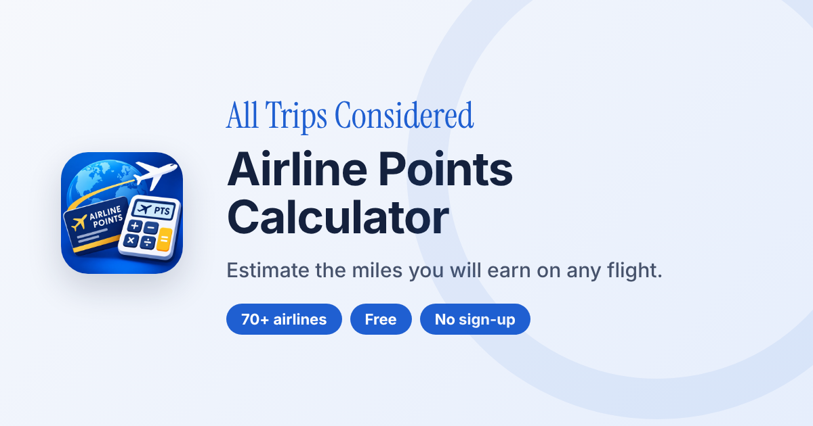

# Airline Points Calculator

A static web app that estimates the points or miles you earn on a flight. It covers 109 airlines in 86 loyalty programs, with status levels, alliance tiers and co-branded credit cards.

Live site: https://points.alltripsconsidered.com/



## Features

### Using the calculator

1. Choose an airline program.
2. Choose your current status (and fare type for Southwest, Breeze, Frontier, Avianca, and Norwegian).
3. Enter the airfare, the carrier-imposed fees, and the taxes & fees separately. Programs that earn by distance or route (Virgin Atlantic, TAP, Qatar, Qantas, and Atmos Rewards when earning by miles or segments) skip these fields.
4. For Alaska or Hawaiian (Atmos Rewards), choose how you earn: miles flown, price paid, or segments flown. Then enter the miles or segments if asked.
5. Say whether you paid with the airline's co-branded credit card, and if so, which one. For distance-based programs, enter the amount charged to the card so its points can be added.
6. The result shows the airline's logo, then one line each for the airline, the membership level with its alliance status (for example "Premier Gold | Star Alliance Gold"), the fare type and the card used. Members with alliance status see their tier badge; basic members of an alliance airline see the alliance logo.
7. **Clear**, next to **Calculate points**, empties every field and returns the form to its starting state.

### Program menu and alliances

- The program menu keeps the United States, Canada, and Mexico at the top and sorts the other countries alphabetically. Each airline has a small circular icon beside its name.
- The menu starts empty on every visit (a program page opens on its own program). A cross in the search box clears it, removes the chosen program and resets the form.
- Typing an airline's two-letter IATA code (such as EW, LL or 4Y) lists that airline first, under "Airline code", above any other matches.
- Typing the start of an airline's name (such as "el al", "united" or "luft") lists that airline first under "Best match". Spaces are optional, so "elal" and "hkexpress" work too.
- Typing a country's two- or three-letter ISO code (such as JP or JPN, CA or CAN, GB, GBR or UK) lists every program in that country. A two-letter code that is also an airline's code shows that airline too (CA: Canada and Air China). The codes are in `data/countries.js`.
- For programs that earn by distance, the airport boxes are searchable dropdowns. Their examples use the airport nearest the airline's headquarters to PHL (such as "From (ORD or city)" for United), from `data/hq-airports.js`. Typing a three-letter code (such as NRT), a metro area code (such as NYC, TYO or LON), a city name (such as Tokyo) or an airport name (such as Haneda) lists the matching airports, best match first. Major cities whose airports carry other town names (Tokyo with Narita, New York with Newark) are listed in `docs/js/distance.js`.
- Miles & More (Lufthansa Group), Flying Blue (Air France, KLM, and Transavia), and IAG are single programs. Each of their airlines is listed under its own country as "Airline | Program", such as "Lufthansa | Miles & More" under Germany. For Miles & More, the airline sets the status earning rate. For IAG, the airline picks the loyalty program: AerClub in euros, British Airways Club in pounds, Iberia Club in euros (Iberia and LEVEL), or Vueling Club in euros, each with its own status levels and cards.
- After a program is chosen, an Alliance line shows oneworld, Star Alliance or SkyTeam for an alliance member. An airline that shares an alliance airline's program without being a member (Eurowings, Air Dolomiti, Edelweiss, Discover, Transavia, LEVEL, Jetstar, HK Express) shows "Not part of [alliance]." with a line that its status is recognized on member airlines but not on its own flights. For any other airline the Alliance line is hidden.
- The level menu is named after the program ("AAdvantage Level", "MileagePlus Level") and lists the airline's own status levels without repeating the program name ("Member", not "MileagePlus Member"; "Gold", not "Egret Gold"). Tier names that need the word stay whole, such as "Breezy 1", and base tiers named after the program ("Matmid", "Suma") are kept. China Southern, China Eastern, EVA Air, Hainan and Hong Kong Airlines drop "Card" from their levels ("Silver", not "Silver Card"), and the base Fortune Wings Club level is "Member".
- United and Southwest also list their debit cards, grouped under Debit cards in the card menu.
- Each program shows the month its rules were last reviewed, for example "Rules last reviewed November 2026."

### How it calculates

- Points are earned on the airfare plus carrier-imposed fees where the program counts them (see below). Taxes & fees are shown in the total cost but do not earn, except on airBaltic and Virgin Australia.

### Carrier fees, surcharges and extras

The second fee field takes each airline's own name for its charge (`carrierLabel`) and a hint that says whether it earns (`carrierHint`). It is hidden when the airline charges none or it never earns (`noCarrier`), and marked "does not earn" when it is charged but excluded (`baseFareOnly`). The extras field (`addons`) appears only where the program says paid extras earn, or is marked as not earning (`addonsNoEarn`). Checked against each program's own pages in November 2026:

- Flying Blue (Air France, KLM): the carrier surcharge earns, and so do extra baggage, seats and à la carte meals for your own trip.
- British Airways Club: carrier-imposed charges earn, and so do paid seats, extra bags and cabin upgrades. Service and change fees do not.
- Iberia Club (Iberia, LEVEL with an IB flight number): carrier charges and additional services (seats, bags, upgrades) earn.
- AerClub: only the fare earns. The terms (clause 10.2) exclude taxes, fees and charges, so Aer Lingus's carrier imposed charge is shown as not earning, and extras do not earn.
- Vueling Club: Avios are earned excluding taxes and fees, and Vueling shows no carrier charge, so the fee field is hidden.
- Miles & More (Lufthansa Group airlines): the ticket price plus the international or national surcharge earns; product and service charges do not.
- Finnair Plus: the surcharge set by Finnair and travel extras bought before the flight earn.
- Norwegian Reward: only the net ticket price earns; taxes, charges and optional services do not, so the fee field is hidden.
- Air Europa SUMA: the published fare and fuel surcharge earn; management and handling fees do not.
- airBaltic Club: the fare, eligible fees including taxes and fuel charges, and extras bought directly from airBaltic earn.
- American AAdvantage, Fiji Airways, United MileagePlus, Air Canada Aeroplan and WestJet Rewards: carrier-imposed fees or surcharges earn. WestJet extras (seats, bags, upgrades) also earn; Aeroplan's do not.
- Delta SkyMiles: carrier-imposed surcharges earn, and so do paid upgrades and Preferred or Comfort seats.
- JetBlue, Southwest, LATAM Pass and GOL Smiles: only the fare earns, so the fee field is hidden. LATAM excludes bags and seats; Smiles excludes fees "of any other nature".
- Frontier (Carrier Interface Charge) and Breeze (Technology Development Charge): the fee earns, and so do bags, seats and other add-ons. Allegiant's Carrier Usage Charge does not earn.
- Porter VIPorter: the NAV charge and fuel, insurance and peak surcharges do not earn; seats, bags and change fees do.
- Air Transat Staria: surcharges do not earn; extras do.
- Aeroméxico Rewards and Avianca LifeMiles: points are on the fare without taxes and fees, so carrier surcharges are shown as not earning. Aeroméxico's wording is the less explicit of the two.
- Volaris altitude: the base fare and Volaris Services (seats, bags, bundles, pets) earn; there is no carrier fee field. The Volaris INVEX 0, INVEX and INVEX 2.0 Mastercards (INVEX, Mexico) earn 15, 17 or 20 points per MX$20 charged at Volaris; no US card exists.
- Viva Aerobus Doters: 1, 1.5 or 2 points per $2 MXN of the fare for Green, Silver and Gold; Doters does not say that seats or bags earn.
- Air India, IndiGo, China Eastern and Xiamen: the fuel surcharge (YQ) earns. IndiGo's Seat Select, Excess Baggage and Fast Forward also earn when bought on its website or app. Xiamen's ancillaries (upgrades, seats, bags, meals, insurance, lounge passes) earn 0.7 miles per yuan plus the tier multiplier, entered in their own field (`addonsRate` with `addonsAddTier`).
- Malaysia Airlines Enrich, Hainan and Hong Kong Airlines: carrier-imposed surcharges (YQ/YR) earn; seats, bags, upgrades and service charges do not.
- Virgin Australia Velocity: points are on the all-inclusive fare, so taxes, fees and carrier charges all earn; extras do not.
- Scoot: service and processing fees do not earn; add-ons do.
- El Al Matmid: surcharges and fees do not earn, so the fee field is hidden; baggage and SPACE seats earn.
- South African Airways Voyager: carrier-imposed fees earn.
- American, Delta, and United cap earning at 75,000 miles per ticket.
- Air Canada and WestJet fares are entered in Canadian dollars (CA$). Viva Aerobus and Volaris fares are entered in Mexican pesos (MX$). British Airways and Virgin Atlantic fares are entered in pounds (£). Fares for the European airlines (Flying Blue, Miles & More, Iberia, LEVEL, Vueling, and TAP) are entered in euros (€). Aeroméxico earns per US dollar, so its fare is entered in US dollars.
- Porter fares are entered in Canadian dollars, Finnair fares in euros, Virgin Australia fares in Australian dollars (A$), and Norwegian fares in Norwegian kroner (kr). Avianca LifeMiles earns per US dollar by fare family.
- Alaska and Hawaiian both use Atmos Rewards. Members choose to earn 1 point per mile, 5 points per dollar, or 500 points per segment, with elite bonuses on each.
- Virgin Atlantic, TAP, and Qatar Airways earn a share of the miles flown set by fare, so they ask for the fare class and the miles flown, not the price paid.
- Qantas awards a fixed number of points per flight, so it asks for the fare and the route band, not the price paid. The table is Qantas' own, for travel from 22 July 2025.
- Jetstar Airways (JQ) earns Qantas Points from Qantas' table for Jetstar-marketed flights. Each fare bundle maps to a Qantas earn category. Starter earns only within New Zealand. Flex, Flex Plus, Max, Mega and More earn at the Economy rate, Starter Max at the Flexible Economy rate, and Business Max at the Business rate. The Minimum Points Guarantee then lifts each flight to at least 800, 1,200 or 1,400 points by fare (400, 800 or 1,200 within New Zealand).
- Jetstar Japan (GK) earns JAL Mileage Bank miles, not Qantas Points. JAL credits 30% of the sector mileage on the Starter Flex and Starter Flex Plus fares, and other fares do not earn. Jetstar Airways (JQ) flights do not earn JAL miles.
- Scoot (TR) earns 1 KrisFlyer mile per S$1 on the base fare and add-ons bought on flyscoot.com, per Scoot's own page. Taxes, Scootsurance, service and processing fees, and voucher amounts do not earn. Scoot publishes no KrisFlyer status bonus. Scoot flights on the same ticket as Singapore Airlines flights earn by distance and are not covered.
- Transavia is one entry for Transavia (HV) and Transavia France (TO), listed under both the Netherlands and France and found by either code. It earns a fixed number of Flying Blue Miles per one-way flight by fare and level, per Flying Blue's Transavia partner page: Explorer 100 on Basic, 250 on Smart or Plus, 500 on Max, with Silver, Gold and Platinum adding 50%, 75% and 100%. All fares earn, Basic included. An airline listed under two countries uses `countries` and `codes` in its data. The old pages for Transavia France and Transavia Netherlands redirect to the new one.
- airBaltic (BT) earns airBaltic Club points on the ticket's total charges, taxes and fuel charges included, and on extra services: 1 point per euro at Club level and 3 at Executive and VIP, plus a fixed bonus on Classic (+50), Flex (+100), Business Experience (+150) and Business (+200). It is the only program where taxes earn (`taxesEarn`); fare bonuses use `addPoints`. The C airBaltic payment card (Citadele) adds 1 point per euro plus 3 from airBaltic on flight tickets.
- El Al (LY) earns Matmid points per US dollar of the ticket price, excluding taxes, fees and surcharges, plus baggage and SPACE seats: 6 for Matmid, 8 for Silver, 9 for Gold, 11 for Platinum and 12 for Top Platinum, from El Al's points page. Bonuses add to the base points: FLEX fares +20%, FLY CARD or FLY CARD PREMIUM SELECT +10%, FLY CARD PREMIUM +20%, and EXECUTIVE Member Circle members +20% in Premium and Business (the circle is for Silver to Top Platinum members living outside Israel, and Matmid members abroad with 2,000 Diamonds or 5,000 points converted from non-Israeli cards in 12 months). Results round to the nearest point (`roundNearest`). The FLY CARD is in the card section, worded "Do you hold an EL AL FLY CARD?" (`cardQuestion`), and adds its bonus to the flight points (`flightBonusPct`) however you pay. Paying with it also earns points per shekel charged, from Isracard's FLY CARD page and April 2026 terms: 1 per ₪5 (FLY CARD), ₪4.50 (FLY CARD PREMIUM SELECT), or ₪4 in shekels and ₪3 in a foreign currency (FLY CARD PREMIUM, Isracard or American Express), per Isracard's FLY CARD page. FLY CARD PREMIUM is one card option; the form then asks whether the ticket was charged in shekels or a foreign currency (`foreignRate`). Foreign-currency charges are billed in shekels plus a 1.8% to 2.5% fee, and the fee earns no points. The shekel amount is optional; left blank, only the flight bonus applies. The EXECUTIVE Circle question uses `extras`, a menu of percentage bonuses. Connecting, package and Sundor tickets earn by destination and booking class and are not covered.
- South African Airways (SA) earns Voyager miles on SAA-operated flights (flight numbers SA001 to SA999) at 1 mile for every R1.60 of the published base fare and carrier-imposed fees, at every status, from Voyager's Earning Miles and Earn - Airline Partners pages. Taxes earn nothing, and the miles are split across the flown sectors of the ticket. The rate shows as "1 mile per R1.60" (`rateText`). SAA codeshare flights on partner aircraft earn by distance and booking class and are not covered. The card section lists the Voyager co-branded cards from Voyager's Earn - Financial Partners page, grouped by bank. Nedbank (South Africa) cards earn 1 mile per R6 (Premium American Express, credit or cheque card), R10.50 (Premium Credit Mastercard), R6.50 (Gold American Express, credit or cheque card) or R11.50 (Gold Credit Mastercard) on the full amount charged. The Nedbank (Mozambique) Visa cards are left out, because only home-market and US cards are shown.
- Aegean (A3) Miles+Bonus earns a fixed amount per domestic flight and, on international flights including Cyprus, the larger of a minimum and a share of the distance: Business 250% (minimum 2,500), Business Basic 220% (2,200), Comfort Flex 200%, 130% or 100% (1,800, 1,400 or 1,000), Flex or Family 150%, 100% or 75% (1,200, 1,000 or 600), and Light 75%, 50% or 30% (600, 400 or 200), by booking-class group. Booking classes group differently on the two charts (E and H move), so the fare menu changes with the route (`zones` on a fare type, `zoneDefaultFare`). Silver, Gold and Platinum add 10%, 20% and 30%. The table matches Aegean's miles-calculator data on all 272 international routes; Aegean's own route distances can be up to about 1% shorter than the airport-to-airport distance used here.
- Oman Air (WY) Sindbad earns 4, 5 or 6 miles per US dollar for Blue, Silver and Gold on the base fare, carrier-imposed surcharges and add-ons, on tickets numbered 910 (other tickets earn by class and distance, not covered).
- Royal Jordanian (RJ) Royal Club earns a share of the distance by booking class, 25% (G, R) to 200% (Crown J) for Bronze Sunbird; Silver Jay, Gold Sparrow and Platinum Hawk add 25%, 50% and 75% of the distance (`bonus` on a status).
- SriLankan (UL) FlySmiLes earns 60% to 225% of the distance by fare family, 50% on group (G) bookings; Gold adds 15% and Platinum 25%.
- Royal Air Maroc (AT) Safar Flyer earns 50% to 200% of the distance by fare family; Silver, Gold and Platinum add 50%, 75% and 100%. The minimum for flights under 500 miles is not published, so none is applied.
- Vietnam Airlines (VN) Lotusmiles earns the distance times a fare-family multiplier (from 26 August 2026), with lower Economy Classic and Lite multipliers on international routes; Titanium, Gold, and Platinum or Million Miler add 30%, 50% and 100%.
- VietJet Air (VJ) SkyJoy earns SkyPoints per VND 10,000 of the base fare, Vietjet surcharges and ancillary services, by tier and fare (Red 0.5 to Diamond 12; Eco, Deluxe, SkyBoss, Business), from SkyJoy terms version 2.1 (30 September 2026). Taxes, VAT and airport and security fees do not earn, and Thai Vietjet flights do not earn. Cards: HDBank Vietjet Classic (3 per VND 10,000) and VPBank YOJO (1 per VND 3,000). Card and flight points are floored with a tiny allowance for floating-point error.
- Loganair (LM) Loganair Loyalty earns a fixed number of Avios per Loganair-operated flight, whatever the distance: 410 on Fly, 650 on Fly Flex and 1,300 on Fly Flex +, since 31 March 2025 (`method: "zone"` with one hidden zone). Each flight of a connection earns, but a through-flight on the same aircraft counts as one. Codeshare flights on other airlines, Orkney inter-isles services, and corporate, negotiated and tour fares do not earn. There are no tiers and no co-branded card.
- Widerøe (WF) is listed under Norwegian Reward. It earns Spenn on the fare, excluding taxes and fees: 1, 2 or 3 per 10 kroner on Mini, Smart and Flex or Full Flex, from Widerøe's help centre. The Extra Spenn benefit (after 8 flights) adds 2 per 10 kroner, and Priority adds 6. Tender (PSO) routes earn nothing, and the CashPoints rates for members outside the Nordics are not published.
- EgyptAir (MS) EgyptAir Plus earns a share of the distance on international flights by booking class, from 25% (E, G, W, T, S) to 200% (C, D, J, Z), with a minimum per flight of 150 to 1,000 miles; P earns 75%. Domestic flights earn that minimum as a fixed amount. Silver, Gold, Elite and Platinum add 20%, 30%, 35% and 40%, from EgyptAir Plus's Earning Miles Policy and Membership Levels pages. The CIB co-brand card rates conflict between EgyptAir and CIB, so they are left out.
- Pegasus Airlines (PC) BolBol earns 1 BolPoint per ₺2 of the total paid for the flight, taxes included, from the Pegasus BolBol General Rules and FAQ. Package upgrades, extra baggage, seats, Pegasus Cafe, Free Cancellation and pets earn at the same rate (`addonsRate`). BolBol Extra doubles the points on the lowest package fare only. Flights bought from online travel agencies and codeshare flights do not earn. Cards: ING Pegasus BolBol Premium and Classic (1 per ₺1 at Pegasus, from ING's card page).
- KM Malta Airlines (KM) KMrewards earns SkyBux (1 SkyBux = EUR 0.01) as a percentage of the base fare, excluding taxes, fees and charges, by fare family: Economy Basic 1.5%, Value 2%, Plus 3% and Flex 4.5%, and Business 5.25% to 8.25%. KM Elite adds 4% (Traveller), 8% (Explorer) or 14% (Pioneer) on those SkyBux. Extras earn 2% with no tier bonus. Results round to the nearest SkyBux, as in KMrewards' Collecting Scenarios.
- Jeju Air (7C) J Point (1 point = KRW 1) earns a percentage of the air fare, excluding fuel surcharges, airport fees and taxes. Booking on Jeju Air's website or app earns 5% (Silver) to 10% (VIP); other channels earn a 2% base plus the same tier bonus (`direct.rate`). Pre-paid bags and seats earn 2%. The KB Kookmin J Point card adds 20 points per ₩1,200 at Jeju Air, from Jeju Air's card benefits page.
- Air Premia (YP) Premia Members earns 7 points per ₩1,000 of the fare paid, after discounts, for Blue; Gold earns 11 and Diamond 15 per ₩1,000 (`ratePer: 1000`). Lite fares earn 70% of that, Standard 100% and Flex 120%, from Air Premia's Information on Earning Points and About Memberships pages (supplied as screenshots, because airpremia.com blocks automated access). Airport tax, the fuel surcharge, other taxes and extras do not earn, and foreign fares convert to won. The official examples (₩300,000: Blue 2,100, Gold 3,300, Diamond 4,500) are tests. Air Premia shows no Gold or Diamond example on a Lite or Flex fare, so the fare share is applied to the tier rate. The logo is the mark from the app icon, since no wordmark file was available.
- SpiceJet (SG) SpiceClub earns SC Points per ₹100 of the base fare and pre-booked add-ons: 4 for Classic, 6 for Silver, 8 for Gold and 10 for Platinum. Booking on spicejet.com or the app adds 250 SC Points per booking (`direct.points`). Taxes and fees do not earn. Cards: Axis Bank SpiceJet Voyage (6 per ₹200) and Voyage Black (12 per ₹200) on SpiceJet website or app spend, counted in whole steps of ₹200 (`spendStep`).
- Tigerair Taiwan (IT) tigerclub earns tigerpoints equal to 1% (tigerexpert) or 2% (tigerprime) of the ticket fare. Only international flights bought on Tigerair Taiwan's own website or app earn. Taxes, booking service fees, bags, seats and meals do not earn. Card: the Rakuten Tigerair Taiwan co-branded card earns 2.5% in tigerpoints on Tigerair Taiwan purchases, up to 500 per statement, until 31 December 2026.
- SKY Airline (H2) SKY Plus earns points per US dollar of the fare plus SKY's bags and seats: Cobre 2.5, Oro 3.3 and Platino 5.8, for SKY Airline Chile and Peru flights, from the SKY Plus page and terms (June 2024). Taxes, fees and third-party services do not earn. Fares in pesos or soles convert to dollars at SKY's rate on the purchase date, so the form asks for US dollars.
- JetSMART (JA) earns AAdvantage miles per US dollar of the fare and pack price, from JetSMART's AAdvantage earning page and American's JetSMART page (since 24 September 2024): 0 on Basic, 2 on Light and 5 on SMART or FULL. Gold, Platinum, Platinum Pro and Executive Platinum add 40%, 60%, 80% and 120%. Following JetSMART's page, taxes, charges and optional extras do not earn (`noCarrier`), and miles round to the nearest mile, as JetSMART's own calculator does (`roundNearest`). It covers JetSMART Chile (JA), Peru (JZ), Argentina (WJ) and Colombia (J6), whose AAdvantage pages show the same rates. Like Transavia, the one entry is listed under each of those four countries (`countries`). JetSMART is listed under AAdvantage like Fiji Airways and is not in oneworld.
- Air Macau (NX) is listed under PhoenixMiles (Air China) like Shenzhen Airlines. It earns a share of the distance in kilometres by booking class, from the PhoenixMiles Air Macau table valid from 1 April 2026: 125% to 250% in Business (800 km minimum), 90% to 110% in Joyful Economy, and 25% to 110% in Economy (500 km minimum). Classes R, A, K, O, I and X earn nothing. PhoenixMiles does not say whether its tier bonuses apply to Air Macau, so only member earning is shown. Cards (Macau): Bank of China Air Card (1 km per MOP 10) and ICBC Air Macau Platinum (1 per MOP 9) and Gold (1 per MOP 10), on all card spending.
- Philippine Airlines (PR) Mabuhay Miles earns a route's base miles times 10% to 150% by fare family. Elite adds 25%; Premier Elite and Million Miler add 75% to and from the US and Canada and 25% elsewhere (`multipliers` per route type), on earned miles in Economy and Premium Economy and on the distance flown in Business (`bonusOnDistance`). PAL's charts list fixed base miles per route, which can differ slightly from the distance entered.
- Cebu Pacific (5J) and Cebgo (DG) Go Rewards earn points per peso of the base fare and fuel surcharge, set by the card type of the Go Rewards number entered in the booking, from the Go Rewards earn rate table (from 22 October 2026) and terms: Classic 1 per ₱80 (promo fares 1 per ₱160), Go Rewards or GoTyme debit card 1 per ₱40 (₱160), and Black or a UnionBank co-brand credit card 1 per ₱20 (₱40). Bags, seats and meals earn at the regular fare rate for the card type, even on a promo fare (`addonsRate` per status). Partner add-ons (1 per ₱160, or ₱40 for Black) and the admin fee (1 per ₱80, or ₱20 for Black) have their own fields (`extraFields`, each with a rate per status). Points are counted to two decimals without rounding (`decimalsFloor`). UnionBank card spend points and the double points promo (3 November to 31 December 2026) are not counted. Go Rewards does not define which fares are promo fares.
- Air Niugini (PX) Destinations earns 1 point per kina of the fare, from the Destinations terms (2 December 2025) and FAQ. Taxes, fees and surcharges do not earn. The terms' tier table (Silver 1.5, Gold 2, Platinum 1.75 per kina) looks inconsistent, so every tier uses the base rate.
- Aircalin (SB) is listed under Flying Blue. It earns a share of the distance by booking class, with separate regional and long-haul tables, from Aircalin's Flying Blue page. Silver adds 50%, Gold 75%, and Platinum and Ultimate 100%, figured on a class share capped at 100% (`bonusOnDistance` on classes above 100%). The New Caledonian Aircalin Amex earns Aircalin Points, not Flying Blue Miles, so it is not shown.
- Air Tahiti Nui (TN) Club Tiare earns 25% to 150% of the distance by booking class (S earns 50% on Papeete-Paris); Silver adds 50% and Gold 75%.
- Aerolíneas Argentinas (AR) Aerolíneas Plus earns a share of the distance by route type (domestic, regional, international) and the first letter of the fare basis, 0% to 200%; Oro, Platino and Diamante add 25%, 75% and 100%.
- Condor (DE) has no frequent flyer program of its own, so it is listed once as "Condor", and the form asks "Which program do you credit Condor flights to?" (TrueBlue or Atmos Rewards). Each choice is an airline in the program (`creditChoice` on the program; `menuLabel` and `menuHidden` on its airlines). TrueBlue earns points per mile flown by Condor fare (Business 2, Premium Economy 1.25, Economy Flex 1, Classic 0.75, Zero, Light or Promo 0.5), from JetBlue's Condor page. Atmos Rewards follows the rules from 1 January 2027: members choose 1 point per mile, 500 per segment, or the price paid; a Condor flight bought from Alaska or Hawaiian earns 5 points per dollar, and one bought elsewhere earns 250%, 100%, 50% or 25% of the distance by cabin. An earning choice can name its method separately from its id (`method` on an `earnMethods` entry), so two choices can both be distance-based. On Atmos Rewards, the statuses show their oneworld tiers and the Alliance line says Atmos status is recognized on oneworld airlines but not guaranteed on Condor flights (`sharedAlliance` on the Atmos choice); on TrueBlue the Alliance line is hidden. Emirates Skywards earning on Condor ended on 1 May 2026; Etihad Guest and Qantas are redemption-only partners.
- Shenzhen Airlines (ZH) is part of the Air China PhoenixMiles entry, with its own class table effective 29 October 2023 (no First class; A is Economy at 25%). The status bonuses shown are Air China's and are not confirmed for Shenzhen Airlines.
- Co-branded cards added in November 2026, each from the issuer's or airline's own page: Qantas (Amex Discovery, ANZ, Westpac, Qantas Money), Virgin Australia (Amex Velocity, Virgin Money), Air New Zealand (Westpac Koru, ANZ Airpoints), Singapore Airlines and Scoot (Amex KrisFlyer Ascend), STARLUX (E.SUN), Thai (THAI Amex Platinum), Malaysia Airlines (AmBank Enrich), Emirates (Emirates NBD Skywards), Etihad (FAB), Turkish (Garanti BBVA), Lufthansa, Eurowings and Discover (Deutsche Bank Miles & More), SWISS and Edelweiss (Swisscard), Icelandair (Íslandsbanki), Aeroméxico (Amex Mexico), Viva Aerobus (HSBC), Copa (BAC Credomatic, Banco General), GOL (Smiles Visa Infinite), Oman Air (Bank Muscat) and Royal Jordanian (Arab Bank, Capital Bank, AJIB). The British Airways Amex Premium Plus now earns a flat 1.25 Avios per pound; its 3 per pound on British Airways ended on 7 October 2026.
- Azul (AD) earns Azul Fidelidade points per real spent on the base airfare of Azul-operated flights: 1 for Básico, 2 for Topázio, 3 for Safira, 4 for Diamante and 5 for Diamante Unique (from January 2026), on every fare type, domestic and international. Government taxes and airport fees do not earn, and Azul has no carrier-imposed fee field (`noCarrier`). Rules verified by the user. Azul is not in an alliance.
- IndiGo (6E) earns BluChips per ₹100 of the base fare and fuel surcharge: 8 for Blu 3, 10 for Blu 2 and 12 for Blu 1 (`ratePer: 100`), from IndiGo's BluChip FAQ as quoted in search results, because goindigo.in blocks automated access. Booking on goindigo.in or the IndiGo app adds 4 per ₹100, asked as a yes or no question (`direct` with a flat `rate`). Taxes and other fees do not earn. IndiGo is not in an alliance. Its co-branded cards (Kotak, HDFC) are not added yet.
- ANA, JAL, and Singapore Airlines KrisFlyer earn a share of the miles flown by booking class. Cathay Pacific awards a fixed amount by fare type and distance zone from Hong Kong. None of them ask for the price paid.
- Malaysia Airlines Enrich earns 1.5 to 2.5 points per ringgit (RM) by status.
- Etihad Guest earns a share of the route distance by fare brand, and adds a status bonus as a share of the distance.
- Emirates is listed for its US co-branded credit cards only. Emirates publishes no earning table, so the calculator asks for the amount charged to the card, shows the card's miles (3 per dollar on Emirates purchases) and marks the flight's own miles as not estimated. The form and the result link to Emirates' Skywards Miles Calculator for the flight. Programs like this use `method: "cardOnly"` and a `flightCalculator` link.
- HK Express is listed for its Cathay co-branded cards only: the US Cathay World Elite Mastercard (3 Asia Miles per US dollar on HK Express travel) and the Hong Kong Standard Chartered Cathay Mastercard. Cathay says HK Express flights do not earn Asia Miles, so the result shows the flight as not earning and counts the card's miles. The Standard Chartered card earns 1 per HK$2 on the first HK$8,000 of Cathay and HK Express spending in a promotion period, then 1 per HK$6. Cards with a spending tier use `tiers` in their card entry.
  - Direct HK Express booking vs. Cathay codeshare: a flight booked directly with HK Express (UO flight number) earns no Asia Miles or Status Points, and bags, seats and meals cost extra. The same flight booked as a Cathay Pacific codeshare (CX flight number, on the same ticket as a Cathay Pacific flight) earns Asia Miles and Status Points by distance and Cathay fare type, with Cathay's baggage, meal and lounge benefits. Both notes appear in the HK Express and Cathay Pacific results. Co-branded card earning is the same either way.
- EVA Air, China Airlines, and STARLUX earn a share of the distance by booking class, so they ask for the class and the miles flown.
- EVA Air's card section, worded "Did you pay with an EVA Air co-brand card?", lists the EVA Air co-brand cards from American Express and Cathay United Bank on EVA's Infinity MileageLands credit card page. The American Express Platinum and Gold charge cards are kept simple at 1 point (1 award mile) per NT$25; their extra miles on EVA Air tickets (50% for Platinum, 67% on the first 2,000 miles a month for Gold) are not counted. Cathay United's Supreme Infinite, Infinite and Supreme Signature cards earn 1 per NT$10 on EVA Air tickets for international EVA Air and UNI Air flights, and its Signature card earns 1 per NT$30. The other cards on EVA's page are left out by choice.
- Icelandair awards fixed Saga Points per flight by fare and route, so it asks for the fare and the route.
- Allegiant earns 1 point per dollar up to $500 and 2 per dollar above that.
- Alliance airlines added in November 2026 follow each airline's published table:
  - Some earn a share of the distance by booking class, with a minimum per flight (Turkish, PhoenixMiles).
  - Some pay a fixed amount on certain routes (Turkish within Türkiye, LOT and Croatia within Europe).
  - Turkish asks for the Route Type (international or within Türkiye) right under the Fare Type (`zoneAfterFare`), with Within Türkiye preselected (`defaultZone`); other programs show the route menu after the amounts.
  - Air China counts kilometres, which the calculator converts from the miles entered.
  - Air New Zealand pays fixed Airpoints by route group, fare, and class. The form asks for the route (From and To, limited to the routes Air New Zealand lists), then the fare (Seat, Seat+Bag, Flexi or The Works, shown only where it matters), then the cabin and booking class. The route group is worked out from the route, so members never pick from the group lists. Programs like this use `routePicker` in their data file.
  - Air Europa, China Eastern, and Xiamen earn on the price paid.
  - SAS EuroBonus pays a fixed number of points per flight by route region and ticket type, with 25% to 75% more for Silver, Gold, and Diamond.
  - GOL (Smiles) and LATAM (LATAM Pass) earn by category and route: GOL per real within South America and per US dollar elsewhere, LATAM per US dollar of the base fare.
  - Fiji Airways uses AAdvantage and earns at American's rates on the US dollar price.
  - Hong Kong Airlines and Hainan Airlines (Fortune Wings Club) earn on the amount spent, in HK$ or yuan, rounded to the nearest 10, plus a status bonus.
  - China Southern earns on the price paid for tickets it issues (number 784). For tickets issued by other airlines, it earns on kilometres by booking class, with a 500 km minimum.
- Only personal co-branded cards are listed; business and corporate cards are left out.
- Empty amount fields show the program's currency code (USD, EUR, TRY) as a placeholder, next to its symbol.
- The Fare Type menu lists fares from lowest to highest earning (by rate, share of distance, fixed points or the base level's rate, compared within one route column). Fares that earn the same keep cabin order, and the default fare is unchanged.
- Co-branded card points are added on top of flight points. They are earned on the full amount charged, taxes included, and are not subject to the per-ticket cap. A card billed in another currency than the fare, such as the US Chase Aeroplan Card, asks for the amount charged in its own currency. Breeze and Viva Aerobus have no card option because their card rates could not be confirmed.

### Airport distances

Distance-based programs can work out the miles flown from two airports. The airport list (about 3,200 airports with scheduled service) is fetched only when a distance-based program is chosen, and `docs/js/distance.js` computes the great-circle distance.

### Airline logos

Every airline, alliance and alliance status badge has a full logo, a square icon and a circular icon (see [`docs/icons/airlines/README.md`](docs/icons/airlines/README.md)). The calculator works without them if they fail to load.


### Appearance

The Appearance panel sets the mode (Auto, Light, Dark) and the accent color. By default the accent follows the selected airline's brand color, and the Color list lets visitors pick any airline's color instead.

### Install and offline use

The site installs as an app and opens offline. `docs/js/install.js` invites visitors to add the calculator to their home screen:

- Chrome, Edge, and Android get an Install button.
- iPhone and iPad get the Share, then Add to Home Screen steps.
- Other phones and tablets whose browser has no install button (such as Firefox or Samsung Internet) are reminded to use the browser menu's Add to Home Screen.
- "Close" hides the message for 24 hours.

### Program pages

Each program has its own page at `/airlines/<name>/` (for example `/airlines/lufthansa/`). The page opens the calculator with that program chosen. It has its own title, description and share-image text, and the description names the airline's alliance when it has one. Each page also gives search engines structured data about the airline: its name, two-letter code, alliance and square logo.

## Privacy

The calculator saves only the light, dark or automatic mode, the chosen color, and when the install message was closed. These stay in the browser's local storage on the device; fares, fees, airports and card choices are never saved, and nothing is uploaded. The full policy is in [`docs/privacy.html`](docs/privacy.html).

## Project structure

Everything the site serves lives in `docs/`, which GitHub Pages publishes. Development files stay at the repository root and are not published.

```text
docs/index.html                   The calculator page
docs/privacy.html                 Privacy policy
docs/airlines/<name>/index.html   One generated page per program (74)
docs/js/app.js                    Calculator, airline search, airport lookup and Appearance panel
docs/js/programs.js               Earning data the browser loads (generated from data/, do not edit)
docs/js/distance.js               Great-circle distance between two airports
docs/js/airports.json             About 3,200 airports with scheduled service (OurAirports)
docs/js/logos.json                Logo and icon files the site loads
docs/js/install.js                Install message and service worker registration
docs/js/theme-boot.js             Applies the saved light or dark mode before the page paints
docs/css/styles.css               Calculator styles
docs/css/privacy.css              Privacy page styles
docs/fonts/                       Instrument Serif font files and OFL.txt
docs/icons/                       App icons, browser tab icons (tabicon-32.png and tabicon-192.png, the All Trips Considered artwork) and og-image.png (link preview image)
docs/icons/airlines/              Airline, alliance and status badge logos (see its README.md)
docs/favicon.ico                  Favicon: the app icon
docs/manifest.webmanifest         App name, icons and colors for installing
docs/sw.js                        Service worker: offline cache
docs/sitemap.xml                  Sitemap with each page's review month (generated)
docs/robots.txt                   Crawler rules (generated)
docs/CNAME                        Custom domain for GitHub Pages
README.md                         This file
data/programs/<program>.js        One file per loyalty program: rules, code, color, source, review month, examples
data/alliances.js                 Alliance of each program or airline, and the alliance tier for each status
data/countries.js                 Country groups in the program menu
data/README.md                    Program file fields and how to add a program
tools/build.js                    Builds docs/js/programs.js from data/, then runs build-pages.js
tools/build-pages.js              Builds the program pages, sitemap.xml and robots.txt
tools/og-image.html               Source for docs/icons/og-image.png
```

### Data design

- Each program's rules, code, color, source, review month and published examples live in one file in `data/programs/`. The browser never reads these files directly.
- `node tools/build.js` checks every program file and stops with a clear message on the first problem, so a bad file never reaches the site. It then writes `docs/js/programs.js` and the search-engine files.
- `docs/js/airports.json` is plain JSON, fetched from this site only when a distance-based program is chosen.
- `docs/sw.js` stays at the top of `docs/` so it can serve the whole site offline. It fetches from the network first, so rate updates show up right away, and falls back to the cache without a connection.

## Run locally

Serve `docs/` with a local web server. The calculator fetches `js/airports.json` and `js/logos.json`, and browsers block those requests on pages opened straight from a file.

```bash
python3 -m http.server 8000 --directory docs
```

Open http://localhost:8000.

`docs/js/install.js` registers the service worker only over HTTPS, so offline use and installing do not work on this local server. Test them on the live site.

## Making changes

### Updating rates

All earning rules, including co-branded card rates, live in `data/programs/`, one file per program. When a program's rules change:

1. Edit its file in `data/programs/`.
2. Set `reviewed` to the current month, for example `"2026-12"`.
3. Add or adjust an entry in its `examples`, using the airline's own published example.
4. Run `node tools/build.js`.

`docs/js/programs.js` is generated. Do not edit it by hand.

### Rebuilding generated files

After changing anything in `data/` or `docs/index.html`, run:

```bash
node tools/build.js
```

This rebuilds `docs/js/programs.js`, the program pages in `docs/airlines/`, `docs/sitemap.xml` and `docs/robots.txt`.

### Adding a program

Copy a similar program's file in `data/programs/`, rename it, and set `id` to the new file name. Then run `node tools/build.js`. See [`data/README.md`](data/README.md) for every field.

### Logos and icons

When you replace a full logo or icon in `docs/icons/airlines/`, rebuild the matching `menu/` or `small/` copy so the site shows the change, and remake `logo-sheet.png`. `docs/icons/airlines/README.md` explains how the icons were made. Most icons come from the airline's App Store icon; where that was shaded or hard to read when small, the icon is rebuilt from the mark in the airline's official vector logo (such as Iberia's wing, SWISS's tail, Austrian's chevron, Brussels Airlines' dots, Croatia Airlines' checkered mark and Aer Lingus' shamrock).

### Search engines and sharing

- `docs/sitemap.xml` gives each program page the month its rules were last reviewed, so search engines can tell when a page changed.
- `docs/icons/og-image.png` is the preview image shown when a link is shared. Its source is `tools/og-image.html`: open it in a browser at 1200 by 630 and take a screenshot to remake the image.

### Releasing an update

When any cached file changes, bump the cache name (`CACHE`) in `docs/sw.js` so installed copies refresh their offline cache. Add any new file the site needs offline to the `SHELL` list in the same file.

## Security

The site follows the All Trips Considered template (`atc-pwa-template`).

- **Content-Security-Policy.** Every page carries the policy as a `<meta>` tag. It forbids inline scripts and styles, `eval` and outside resources.
- **Trusted Types are enforced.** The browser blocks `innerHTML`, `insertAdjacentHTML`, `document.write` and script URLs. Build the interface with `textContent`, `createElement` and `replaceChildren()`. The only allowed policy is `sw`, which accepts nothing but `sw.js` so the service worker can register.
- **Self-hosted fonts and no third-party requests.** Scripts, styles, fonts and data load only from this site. The Instrument Serif font is self-hosted in `docs/fonts/`.
- **Checked input.** Saved values are checked against known options before use, and the airport list is plain JSON fetched from this site.

### Headers to set in Cloudflare

GitHub Pages cannot send custom headers, so they are set with a Cloudflare Transform Rule (Rules > Transform Rules > Modify Response Header) for hostname `points.alltripsconsidered.com`. The `points` DNS record must be **Proxied** (orange cloud), with SSL/TLS set to **Full (strict)**. The rule sets these headers:

- `Content-Security-Policy: default-src 'self'; script-src 'self'; style-src 'self'; font-src 'self'; img-src 'self' data:; connect-src 'self'; manifest-src 'self'; worker-src 'self'; object-src 'none'; base-uri 'self'; form-action 'none'; frame-ancestors 'none'; require-trusted-types-for 'script'; trusted-types sw; upgrade-insecure-requests`
- `Strict-Transport-Security: max-age=63072000; includeSubDomains`
- `X-Content-Type-Options: nosniff`
- `X-Frame-Options: DENY`
- `Referrer-Policy: strict-origin-when-cross-origin`
- `Permissions-Policy: camera=(), microphone=(), geolocation=(), payment=(), usb=(), browsing-topics=()`
- `Cross-Origin-Opener-Policy: same-origin`
- `Cross-Origin-Resource-Policy: same-origin`

The header policy matches the `<meta>` one, plus `frame-ancestors 'none'`, which only works as a header. `base-uri` is `'self'` rather than the template's `'none'` because the program pages use `<base>`. Add `preload` to the HSTS header only when every `alltripsconsidered.com` subdomain is permanently HTTPS-only.

## Deployment

GitHub Pages publishes the `/docs` folder of the `prod` branch (Settings > Pages > Deploy from a branch). `docs/CNAME` sets the custom domain, and Cloudflare provides DNS. `prod` is the default branch. Changes reach it only through an approved pull request, and the site updates a few minutes after a merge.

## Roadmap

Each new program needs an official, complete earning table before it is built. Many of these airlines' websites block automated access, so a screenshot or PDF of the earning page is the quickest way to add one.

### Programs to add

Researched in November 2026. Each one is blocked on an official source, so a screenshot or PDF of the earning page is the quickest way to add it.

- [ ] **Garuda Indonesia GarudaMiles** (Asia): the 8 September 2025 class table (F, A, P 400% down to E, U, Z 2%) and the Gold and Platinum +25% bonus are known only from search summaries. Needs the distance basis, rounding and the BNI card rates. garuda-indonesia.com and bni.co.id are behind Cloudflare.
- [ ] **Ethiopian Airlines ShebaMiles** (Africa): the terms cite a Miles Chart that is not online, and the official calculator works on the server. The written status bonus (Silver 25%, Gold 75%, Platinum 100% of base miles) also does not match the calculator, which adds those shares of the distance. Ethiopian co-brand cards (Abyssinia, Awash, Hibir) are confirmed.
- [ ] **Kenya Airways Asante Rewards** (Africa): the terms say points depend on route and fare class or cabin, but no chart is published; the portal loads its text from an API that could not be read. The Absa Asante Global Visa (September 2026) has no published rate.
- [ ] **Saudia Alfursan** (Middle East, SkyTeam): saudia.com blocks automated access. Search snippets show a newer fare-family table (Guest Saver 0%, Basic 60%, Semi Flex 80%, Flex 110%; Business Basic 175%, Semi Flex 225% and Flex 250% international, 125%, 150% and 175% domestic) that conflicts with two older tables. First class, status bonuses and the effective date are unconfirmed. Card: ANB AlFursan Infinite earns 1 mile per SAR 3 domestic and SAR 2 abroad (official).
- [ ] **Middle East Airlines Cedar Miles** (SkyTeam): both MEA sites are behind Cloudflare, and search snippets give three conflicting class tables. Status bonuses are Silver 25%, Gold 50% and Platinum 75%.
- [ ] **TAROM** (SkyTeam): earns Flying Blue Miles by distance and booking class (TAROM's own page), but flyingblue.com's TAROM table could not be reached.
- [ ] **Bangkok Airways FlyerBonus** (Asia): sector points by route and class (J, C, D 150%; Y group 100%; Q, V, G, B 50%; R, P, A, O 10%) with a minimum per route. flyerbonus.bangkokair.com blocks access, so the route chart could not be read. Tiers are Premier and Premier Plus.
- [ ] **SunExpress** (Türkiye): sunexpress.com is behind Cloudflare. Snippets show 1 point per euro on the total including taxes and extras for own-channel bookings, Silver 1.5 and Gold 1.75 per euro on extras, and 100 points per one-way agency booking. The Silver threshold conflicts, and rounding is not published.
- [ ] **Jin Air Nabi Points** (Korea): fixed points per one-way flight by route (domestic 10, Japan 15 to 20) times a fare percentage. The per-route table is behind Cloudflare. Merges with Air Busan and Air Seoul on 17 March 2027.
- [ ] **Air Busan FLY & STAMP** (Korea): stamps per one-way flight by route group (official rules PDF), but the route table is behind Cloudflare and snippets conflict. Merges into Jin Air on 17 March 2027.
- [ ] **Azores Airlines SATA IMAGINE** (Portugal): a fare-family share (10% to 200%) of each route's base miles, with Silversky +20% and Goldsky +30%. The base miles appear only in the member calculator, and no official rule ties them to distance.
- [ ] **AirAsia rewards** (Asia): Table E of the Membership Agreement gives Premium Flex and Premium Flatbed exactly (2, 4, 7 and 12 per RM1 for Red, Gold, Platinum and Black), but Low Fare only as a maximum ("up to" 1.5, 3, 5.5 and 10). The earning components are not stated. Covers AK, FD, QZ, Z2, KT, D7, and XJ from 1 January 2026. Source: https://www.airasia.com/aa/rewards/en/gb/rewards-membership.html
- [ ] **Binter BinterMás** (Spain): removed in November 2026. Inter-island flights earn fixed points by fare (SuperPromo 0, Promo 50, Económica 75, Flexible 100, FlexiMás 200), but mainland and international points vary by route with no complete table, and Binter's fares page (Madrid 150, 300, 900, 1,200) conflicts with its booking engine (150, 600, 1,000, 1,600).

### No earning program (checked November 2026)

- Air Greenland (Club Timmisa is a prize draw), TUI (Smiles count only toward levels and cannot be spent), Volotea (Megavolotea is a paid discount membership), Lion Air Group (BookCabin CabinClub publishes no earning rate), French bee, SKY express, Sunclass, Greater Bay Airlines, Czech Airlines, Smartwings, Neos, Aeroitalia, Jet2, Flair, Wingo, Air Seoul and Eastar Jet.

### Alliance members not yet in the calculator

- [ ] **oneworld:** none left. Philippine Airlines (in the calculator) is reported to join in 2027.
- [ ] **Star Alliance:** Ethiopian ShebaMiles (above). Asiana leaves Star Alliance in December 2026 and is on the watch list.
- [ ] **SkyTeam:** Middle East Airlines, TAROM, Saudia, Garuda Indonesia and Kenya Airways (all above).

### Credit cards to add

Each card needs its current earning rate on airline purchases, confirmed from the issuer or the airline, before it is added. Only personal cards issued in the airline's home country or the US are shown. Business and corporate cards are left out.

Added in November 2026: Amex KrisFlyer Credit Card (Singapore Airlines and Scoot); Inbursa Aeroméxico Ascend, Elevate, Horizon and debit; Cardless TAP Miles&Go and Millennium bcp TAP Classic, Gold and Platinum; Cardless Avianca LifeMiles Amex and Amex Elite, and Bancolombia Visa LifeMiles (the Banco Popular Avianca Vuela Visa was removed, as Banco Popular closed its Avianca cards in 2022); Aktia Finnair Visa Credit by tier and Credit Light; Alpha Bank Aegean Bonus Visa Debit; Cornèrcard Miles & More (SWISS and Edelweiss); Erste and Sparkasse Austrian Miles & More Premiumcard; Beobank Brussels Airlines Explore, Horizon and Altitude; and AlRayan Bank Qatar Airways Visa Infinite and Signature.

- [ ] **Home-market cards to confirm:** the official page was blocked or unclear for BBVA Iberia, Air Europa SUMA, Santander Chile LATAM Pass, Azul Itaú, Bank Norwegian, SAS EuroBonus cards, Alpha Bank Aegean Bonus Visa and Visa Premium credit cards, Hyundai Korean Air, JAL Card, CTBC China Airlines, CITIC Hong Kong Airlines, IndiGo cards (IDFC, Axis, SBI, Kotak), Chinese airline co-brands and ANA cards (Mile Plus rule). CaixaBank Vueling rates appear to include Vueling Club flight earning, so the card's own share is unclear. Pekao's card is a generic Miles & More option, not a LOT co-brand.
- [ ] **Future US cards:** for any program in the calculator, check for new US co-branded cards from time to time. As of November 2026, the US cards for Etihad, Turkish, Qatar, LATAM, Emirates, ANA, Miles & More, TAP and Avianca are current.

The two South African Airways Voyager "$" Mastercards are Ecobank Ghana cards that earn per US dollar, so they are not home-market cards and are not shown.

### Site improvements

- [ ] **Report a correction:** a footer link, by email or a simple form, so readers can report changed earning rules.
- [ ] **Review schedule:** a reminder every six months listing programs whose `reviewed` month is older than six months, so the "Rules last reviewed" dates stay current.
- [ ] **Visit counter:** a privacy-friendly counter (for example Plausible or GoatCounter, with no cookies or consent banner) to see which programs people use. If added, the footer should say so.
- [ ] **"100+ airlines" wording:** the page titles, descriptions and preview image say "100+ airlines" and "80+ loyalty programs" (109 airlines in 86 programs today). Update the wording and remake the preview image (`tools/og-image.html`) when the count passes 150 airlines or 90 programs.

### Watch list

These are not added yet. Each says what would change that.

- Miles & More credit cards (Germany): earn 1 mile per €2 everywhere, with no bonus on Lufthansa tickets, so they are not added. Add them if a Lufthansa purchase bonus appears.
- Sun Country Rewards: merging into Allegiant Allways Rewards, likely by about May 2028. Not added for that reason.
- Asiana Club: merging into Korean Air SKYPASS. Not added for that reason.
- HK Express: its flights do not earn Asia Miles; only the Standard Chartered Cathay Mastercard and short promotions do. Add flight earning if Cathay starts awarding Asia Miles on HK Express flights.
- Peach (MM): ANA group low-cost airline. Its own flights do not earn ANA Mileage Club miles; only flights booked under an ANA (NH) codeshare number on selected routes do. ANA miles can be traded for Peach Points, but that is redemption, not earning. Add Peach if its own flights start earning ANA miles.
- Spring Japan (IJ): JAL group low-cost airline. JAL Mileage Bank says flights operated by Spring Airlines do not earn; miles accrue only on flights booked and flown under JAL flight numbers. Add Spring Japan if its own flights start earning JMB miles.
- ZIPAIR (ZG): JAL group low-cost long-haul airline. Its flights earn neither ZIPAIR Points (ZIPAIR says points are not earned for flights or ticket purchases; they come from sign-up, the app and JAL mile conversions) nor JAL Mileage Bank miles (only JAL flight numbers earn). It has no co-branded card. Source: ZIPAIR's Point Club press release (1 April 2021, https://www.zipair.net/en/notification/41), which says points "cannot be earned by purchasing tickets, boarding flights, or purchasing products"; JAL miles convert to ZIPAIR Points at 1 to 1.5 per mile, and 2 ZIPAIR Points convert to 1 JAL mile. ZIPAIR's current ZIPAIR Points page (https://www.zipair.net/en/membership/point, checked November 2026) still lists only four ways to earn: joining Point Club (100), joining Point Club Plus (1,000), first app login (100) and exchanging JAL miles. JAL's ZIPAIR Points page covers only account linking and exchanges. Add ZIPAIR if its flights start earning points or miles.
- Air Transat Staria credit cards: Desjardins and Visa plan cards that earn Staria points, launching later in 2027. Fees and earning rates are not yet published. Add them to the Air Transat entry once they launch.

## Disclaimer

Estimates only. Earning rules change often and promotions, credit cards, partner flights, and fare classes can change the result. Check your program's official terms before you rely on a number.

## Credits and licenses

- **Font:** Instrument Serif, self-hosted under the SIL Open Font License (`docs/fonts/OFL.txt`).
- **Airport data:** [OurAirports](https://ourairports.com/data/) (public domain), in `docs/js/airports.json`.
- **Airline and alliance logos:** trademarks of their owners. `docs/icons/airlines/index.json` records each logo's source and license; some come from Wikimedia Commons.
- **Earning rules:** from each program's published terms. Each file in `data/programs/` links its `source`.

<p align="center">
  
</p>

<p align="center">© 2026 All Trips Considered. All rights reserved.</p>
