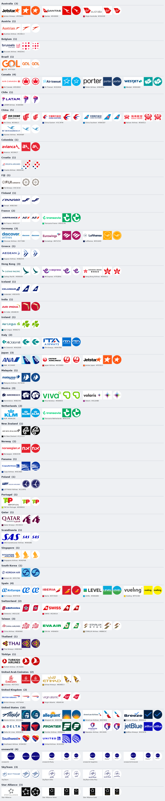
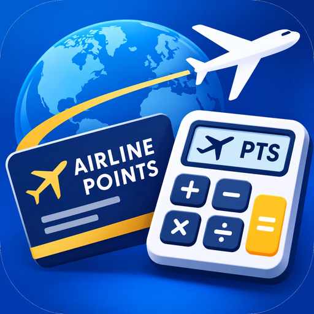

# Airline Points Calculator

A static web app that estimates the points or miles you earn on a flight. It covers 74 airlines in 56 loyalty programs, with status levels, alliance tiers and co-branded credit cards.

Live site: https://points.alltripsconsidered.com/


## Features

### Using the calculator

1. Choose an airline program.
2. Choose your current status (and fare type for Southwest, Breeze, Frontier, Avianca, and Norwegian).
3. Enter the airfare, the carrier-imposed fees, and the taxes & fees separately. Programs that earn by distance or route (Virgin Atlantic, TAP, Qatar, Qantas, and Atmos Rewards when earning by miles or segments) skip these fields.
4. For Alaska or Hawaiian (Atmos Rewards), choose how you earn: miles flown, price paid, or segments flown. Then enter the miles or segments if asked.
5. Say whether you paid with the airline's co-branded credit card, and if so, which one. For distance-based programs, enter the amount charged to the card so its points can be added.
6. The result shows the airline's logo, then one line each for the airline, the membership level with its alliance status (for example "Premier Gold | Star Alliance Gold"), the fare type and the card used. Members with alliance status see their tier badge; basic members of an alliance airline see the alliance logo.

### Program menu and alliances

- The program menu keeps the United States, Canada, and Mexico at the top and sorts the other countries alphabetically. Each airline has a small circular icon beside its name.
- The menu starts empty on every visit (a program page opens on its own program). A cross in the search box clears it, removes the chosen program and resets the form.
- Typing an airline's two-letter IATA code (such as EW, LL or 4Y) lists that airline first, under "Airline code", above any other matches.
- Typing the start of an airline's name (such as "el al", "united" or "luft") lists that airline first under "Best match". Spaces are optional, so "elal" and "hkexpress" work too.
- Typing a country's two- or three-letter ISO code (such as JP or JPN, CA or CAN, GB, GBR or UK) lists every program in that country. A two-letter code that is also an airline's code shows that airline too (CA: Canada and Air China). The codes are in `data/countries.js`.
- For programs that earn by distance, the airport boxes are searchable dropdowns. Their examples use the airport nearest the airline's headquarters to PHL (such as "From (ORD or city)" for United), from `data/hq-airports.js`. Typing a three-letter code (such as NRT), a metro area code (such as NYC, TYO or LON), a city name (such as Tokyo) or an airport name (such as Haneda) lists the matching airports, best match first. Major cities whose airports carry other town names (Tokyo with Narita, New York with Newark) are listed in `docs/js/distance.js`.
- Miles & More (Lufthansa Group), Flying Blue (Air France, KLM, and Transavia), and IAG are single programs. Each of their airlines is listed under its own country as "Airline | Program", such as "Lufthansa | Miles & More" under Germany. For Miles & More, the airline sets the status earning rate. For IAG, the airline picks the loyalty program: AerClub in euros, British Airways Club in pounds, Iberia Club in euros (Iberia and LEVEL), or Vueling Club in euros, each with its own status levels and cards.
- After a program is chosen, an Alliance line shows oneworld, Star Alliance, SkyTeam, or "Not part of an alliance" for the chosen airline. An airline that shares an alliance airline's program without being a member (Eurowings, Air Dolomiti, Edelweiss, Discover, Transavia, LEVEL, Jetstar, Jetstar Japan, HK Express) shows "Not part of [alliance name]." (such as "Not part of Star Alliance.") and a line that the status is recognized on the alliance's member airlines, but alliance benefits are not guaranteed on its own flights. Its result shows no alliance tier. Memberships were checked in November 2026, including Fiji Airways (full oneworld member), Hawaiian (oneworld) and ITA Airways (Star Alliance).
- Status levels show the matching alliance tier when the airline is in an alliance, such as "AAdvantage Gold | Ruby" (oneworld), "Premier Silver | Silver" (Star Alliance), or "Gold Medallion | Elite Plus" (SkyTeam).
- United and Southwest also list their debit cards, grouped under Debit cards in the card menu.
- Each program shows the month its rules were last reviewed, for example "Rules last reviewed November 2026."

### How it calculates

- Points are earned on the airfare plus carrier-imposed fees (Southwest and Allegiant: airfare only). Taxes & fees are shown in the total cost but do not earn.
- American, Delta, and United cap earning at 75,000 miles per ticket.
- Air Canada and WestJet fares are entered in Canadian dollars (CA$). Viva Aerobus and Volaris fares are entered in Mexican pesos (MX$). British Airways and Virgin Atlantic fares are entered in pounds (£). Fares for the European airlines (Flying Blue, Miles & More, Iberia, LEVEL, Vueling, and TAP) are entered in euros (€). Aeroméxico earns per US dollar, so its fare is entered in US dollars.
- Porter fares are entered in Canadian dollars, Finnair fares in euros, Virgin Australia fares in Australian dollars (A$), and Norwegian fares in Norwegian kroner (kr). Avianca LifeMiles earns per US dollar by fare family.
- Alaska and Hawaiian both use Atmos Rewards. Members choose to earn 1 point per mile, 5 points per dollar, or 500 points per segment, with elite bonuses on each.
- Virgin Atlantic, TAP, and Qatar Airways earn a share of the miles flown set by fare, so they ask for the fare class and the miles flown, not the price paid.
- Qantas awards a fixed number of points per flight, so it asks for the fare and the route band, not the price paid. The table is Qantas' own, for travel from 22 July 2025.
- Jetstar Airways (JQ) earns Qantas Points from Qantas' table for Jetstar-marketed flights. Each fare bundle maps to a Qantas earn category. Starter earns only within New Zealand. Flex, Flex Plus, Max, Mega and More earn at the Economy rate, Starter Max at the Flexible Economy rate, and Business Max at the Business rate. The Minimum Points Guarantee then lifts each flight to at least 800, 1,200 or 1,400 points by fare (400, 800 or 1,200 within New Zealand).
- Jetstar Japan (GK) earns JAL Mileage Bank miles, not Qantas Points. JAL credits 30% of the sector mileage on the Starter Flex and Starter Flex Plus fares, and other fares do not earn. Jetstar Airways (JQ) flights do not earn JAL miles.
- Scoot (TR) earns 1 KrisFlyer mile per S$1 on the base fare and add-ons bought on flyscoot.com, per Scoot's own page. Taxes, Scootsurance, service and processing fees, and voucher amounts do not earn. Scoot publishes no KrisFlyer status bonus. Scoot flights on the same ticket as Singapore Airlines flights earn by distance and are not covered.
- Transavia is one entry for Transavia (HV) and Transavia France (TO), listed under both the Netherlands and France and found by either code. It earns a fixed number of Flying Blue Miles per one-way flight by fare and level, per Flying Blue's Transavia partner page: Explorer 100 on Basic, 250 on Smart or Plus, 500 on Max, with Silver, Gold and Platinum adding 50%, 75% and 100%. All fares earn, Basic included. An airline listed under two countries uses `countries` and `codes` in its data. The old pages for Transavia France and Transavia Netherlands redirect to the new one.
- airBaltic (BT) earns airBaltic Club points on the ticket's total charges, taxes and fuel charges included, and on extra services: 1 point per euro at Club level and 3 at Executive and VIP, plus a fixed bonus on Classic (+50), Flex (+100), Business Experience (+150) and Business (+200). It is the only program where taxes earn (`taxesEarn`); fare bonuses use `addPoints`. The C airBaltic payment card (Citadele) adds 1 point per euro plus 3 from airBaltic on flight tickets.
- El Al (LY) earns Matmid points per US dollar of the ticket price, excluding taxes, fees and surcharges, plus baggage and SPACE seats: 6 for Matmid, 8 for Silver, 9 for Gold, 11 for Platinum and 12 for Top Platinum, from El Al's points page. Bonuses add to the base points: FLEX fares +20%, FLY CARD or FLY CARD PREMIUM SELECT +10%, FLY CARD PREMIUM +20%, and EXECUTIVE Circle members +20% in Premium and Business. Results round to the nearest point (`roundNearest`). The FLY CARD is in the card section, worded "Do you hold an EL AL FLY CARD?" (`cardQuestion`), and adds its bonus to the flight points (`flightBonusPct`) however you pay. Paying with it also earns points per shekel charged, from Isracard's FLY CARD page and April 2026 terms: 1 per ₪5 (FLY CARD), ₪4.50 (FLY CARD PREMIUM SELECT), or ₪4 in shekels and ₪3 in a foreign currency (FLY CARD PREMIUM, including the American Express version). The shekel amount is optional; left blank, only the flight bonus applies. The EXECUTIVE Circle question uses `extras`, a menu of percentage bonuses. Connecting, package and Sundor tickets earn by destination and booking class and are not covered.
- ANA, JAL, and Singapore Airlines KrisFlyer earn a share of the miles flown by booking class. Cathay Pacific awards a fixed amount by fare type and distance zone from Hong Kong. None of them ask for the price paid.
- Malaysia Airlines Enrich earns 1.5 to 2.5 points per ringgit (RM) by status.
- Etihad Guest earns a share of the route distance by fare brand, and adds a status bonus as a share of the distance.
- Emirates is listed for its US co-branded credit cards only. Emirates publishes no earning table, so the calculator asks for the amount charged to the card, shows the card's miles (3 per dollar on Emirates purchases) and marks the flight's own miles as not estimated. The form and the result link to Emirates' Skywards Miles Calculator for the flight. Programs like this use `method: "cardOnly"` and a `flightCalculator` link.
- HK Express is listed for its Cathay co-branded cards only: the US Cathay World Elite Mastercard (3 Asia Miles per US dollar on HK Express travel) and the Hong Kong Standard Chartered Cathay Mastercard. Cathay says HK Express flights do not earn Asia Miles, so the result shows the flight as not earning and counts the card's miles. The Standard Chartered card earns 1 per HK$2 on the first HK$8,000 of Cathay and HK Express spending in a promotion period, then 1 per HK$6. Cards with a spending tier use `tiers` in their card entry.
  - Direct HK Express booking vs. Cathay codeshare: a flight booked directly with HK Express (UO flight number) earns no Asia Miles or Status Points, and bags, seats and meals cost extra. The same flight booked as a Cathay Pacific codeshare (CX flight number, on the same ticket as a Cathay Pacific flight) earns Asia Miles and Status Points by distance and Cathay fare type, with Cathay's baggage, meal and lounge benefits. Both notes appear in the HK Express and Cathay Pacific results. Co-branded card earning is the same either way.
- EVA Air, China Airlines, and STARLUX earn a share of the distance by booking class, so they ask for the class and the miles flown.
- Icelandair awards fixed Saga Points per flight by fare and route, so it asks for the fare and the route.
- Allegiant earns 1 point per dollar up to $500 and 2 per dollar above that.
- Alliance airlines added in November 2026 follow each airline's published table:
  - Some earn a share of the distance by booking class, with a minimum per flight (Turkish, PhoenixMiles).
  - Some pay a fixed amount on certain routes (Turkish within Türkiye, LOT and Croatia within Europe).
  - Air China counts kilometres, which the calculator converts from the miles entered.
  - Air New Zealand pays fixed Airpoints by route group, fare, and class. The form asks for the route (From and To, limited to the routes Air New Zealand lists), then the fare (Seat, Seat+Bag, Flexi or The Works, shown only where it matters), then the cabin and booking class. The route group is worked out from the route, so members never pick from the group lists. Programs like this use `routePicker` in their data file.
  - Air Europa, China Eastern, and Xiamen earn on the price paid.
  - SAS EuroBonus pays a fixed number of points per flight by route region and ticket type, with 25% to 75% more for Silver, Gold, and Diamond.
  - GOL (Smiles) and LATAM (LATAM Pass) earn by category and route: GOL per real within South America and per US dollar elsewhere, LATAM per US dollar of the base fare.
  - Fiji Airways uses AAdvantage and earns at American's rates on the US dollar price.
  - Hong Kong Airlines and Hainan Airlines (Fortune Wings Club) earn on the amount spent, in HK$ or yuan, rounded to the nearest 10, plus a status bonus.
  - China Southern earns on the price paid for tickets it issues (number 784). For tickets issued by other airlines, it earns on kilometres by booking class, with a 500 km minimum.
- Co-branded card points are added on top of flight points. They are earned on the full amount charged, taxes included, and are not subject to the per-ticket cap. A card billed in another currency than the fare, such as the US Chase Aeroplan Card, asks for the amount charged in its own currency. Breeze and Viva Aerobus have no card option because their card rates could not be confirmed.

### Airport distances

Distance-based programs can work out the miles flown from two airports. The airport list (about 3,200 airports with scheduled service) is fetched only when a distance-based program is chosen, and `docs/js/distance.js` computes the great-circle distance.

### Airline logos

Every airline, alliance and alliance status badge has a full logo, a square icon and a circular icon (see [`docs/icons/airlines/README.md`](docs/icons/airlines/README.md)). The calculator works without them if they fail to load.



### Appearance

The Appearance panel sets the mode (Auto, Light, Dark) and the accent color. By default the accent follows the selected airline's brand color, and the Color list lets visitors pick any airline's color instead.

### Install and offline use

The site installs as an app and opens offline. `docs/js/install.js` invites visitors to add the calculator to their home screen:

- Chrome, Edge, and Android get an Install button.
- iPhone and iPad get the Share, then Add to Home Screen steps.
- Other phones and tablets whose browser has no install button (such as Firefox or Samsung Internet) are reminded to use the browser menu's Add to Home Screen.
- "Close" hides the message for 24 hours.

### Program pages

Each program has its own page at `/airlines/<name>/` (for example `/airlines/lufthansa/`). The page opens the calculator with that program chosen. It has its own title, description and share-image text, and the description names the airline's alliance when it has one. Each page also gives search engines structured data about the airline: its name, two-letter code, alliance and square logo.

## Privacy

The calculator saves only the light, dark or automatic mode, the chosen color, and when the install message was closed. These stay in the browser's local storage on the device; fares, fees, airports and card choices are never saved, and nothing is uploaded. The full policy is in [`docs/privacy.html`](docs/privacy.html).

## Project structure

Everything the site serves lives in `docs/`, which GitHub Pages publishes. Development files stay at the repository root and are not published.

```text
docs/index.html                   The calculator page
docs/privacy.html                 Privacy policy
docs/airlines/<name>/index.html   One generated page per program (74)
docs/js/app.js                    Calculator, airline search, airport lookup and Appearance panel
docs/js/programs.js               Earning data the browser loads (generated from data/, do not edit)
docs/js/distance.js               Great-circle distance between two airports
docs/js/airports.json             About 3,200 airports with scheduled service (OurAirports)
docs/js/logos.json                Logo and icon files the site loads
docs/js/install.js                Install message and service worker registration
docs/js/theme-boot.js             Applies the saved light or dark mode before the page paints
docs/css/styles.css               Calculator styles
docs/css/privacy.css              Privacy page styles
docs/fonts/                       Instrument Serif font files and OFL.txt
docs/icons/                       App icons, browser tab icons (tabicon-32.png and tabicon-192.png, the All Trips Considered artwork) and og-image.png (link preview image)
docs/icons/airlines/              Airline, alliance and status badge logos (see its README.md)
docs/favicon.ico                  Favicon: the app icon
docs/manifest.webmanifest         App name, icons and colors for installing
docs/sw.js                        Service worker: offline cache
docs/sitemap.xml                  Sitemap with each page's review month (generated)
docs/robots.txt                   Crawler rules (generated)
docs/CNAME                        Custom domain for GitHub Pages
README.md                         This file
data/programs/<program>.js        One file per loyalty program: rules, code, color, source, review month, examples
data/alliances.js                 Alliance of each program or airline, and the alliance tier for each status
data/countries.js                 Country groups in the program menu
data/README.md                    Program file fields and how to add a program
tools/build.js                    Builds docs/js/programs.js from data/, then runs build-pages.js
tools/build-pages.js              Builds the program pages, sitemap.xml and robots.txt
tools/og-image.html               Source for docs/icons/og-image.png
```

### Data design

- Each program's rules, code, color, source, review month and published examples live in one file in `data/programs/`. The browser never reads these files directly.
- `node tools/build.js` checks every program file and stops with a clear message on the first problem, so a bad file never reaches the site. It then writes `docs/js/programs.js` and the search-engine files.
- `docs/js/airports.json` is plain JSON, fetched from this site only when a distance-based program is chosen.
- `docs/sw.js` stays at the top of `docs/` so it can serve the whole site offline. It fetches from the network first, so rate updates show up right away, and falls back to the cache without a connection.

## Run locally

Serve `docs/` with a local web server. The calculator fetches `js/airports.json` and `js/logos.json`, and browsers block those requests on pages opened straight from a file.

```bash
python3 -m http.server 8000 --directory docs
```

Open http://localhost:8000.

`docs/js/install.js` registers the service worker only over HTTPS, so offline use and installing do not work on this local server. Test them on the live site.

## Making changes

### Updating rates

All earning rules, including co-branded card rates, live in `data/programs/`, one file per program. When a program's rules change:

1. Edit its file in `data/programs/`.
2. Set `reviewed` to the current month, for example `"2026-12"`.
3. Add or adjust an entry in its `examples`, using the airline's own published example.
4. Run `node tools/build.js`.

`docs/js/programs.js` is generated. Do not edit it by hand.

### Rebuilding generated files

After changing anything in `data/` or `docs/index.html`, run:

```bash
node tools/build.js
```

This rebuilds `docs/js/programs.js`, the program pages in `docs/airlines/`, `docs/sitemap.xml` and `docs/robots.txt`.

### Adding a program

Copy a similar program's file in `data/programs/`, rename it, and set `id` to the new file name. Then run `node tools/build.js`. See [`data/README.md`](data/README.md) for every field.

### Logos and icons

When you replace a full logo or icon in `docs/icons/airlines/`, rebuild the matching `menu/` or `small/` copy so the site shows the change, and remake `logo-sheet.png`. `docs/icons/airlines/README.md` explains how the icons were made. Most icons come from the airline's App Store icon; where that was shaded or hard to read when small, the icon is rebuilt from the mark in the airline's official vector logo (such as Iberia's wing, SWISS's tail, Austrian's chevron, Brussels Airlines' dots, Croatia Airlines' checkered mark and Aer Lingus' shamrock).

### Search engines and sharing

- `docs/sitemap.xml` gives each program page the month its rules were last reviewed, so search engines can tell when a page changed.
- `docs/icons/og-image.png` is the preview image shown when a link is shared. Its source is `tools/og-image.html`: open it in a browser at 1200 by 630 and take a screenshot to remake the image.

### Releasing an update

When any cached file changes, bump the cache name (`CACHE`) in `docs/sw.js` so installed copies refresh their offline cache. Add any new file the site needs offline to the `SHELL` list in the same file.

## Security

The site follows the All Trips Considered template (`atc-pwa-template`).

- **Content-Security-Policy.** Every page carries the policy as a `<meta>` tag. It forbids inline scripts and styles, `eval` and outside resources.
- **Trusted Types are enforced.** The browser blocks `innerHTML`, `insertAdjacentHTML`, `document.write` and script URLs. Build the interface with `textContent`, `createElement` and `replaceChildren()`. The only allowed policy is `sw`, which accepts nothing but `sw.js` so the service worker can register.
- **Self-hosted fonts and no third-party requests.** Scripts, styles, fonts and data load only from this site. The Instrument Serif font is self-hosted in `docs/fonts/`.
- **Checked input.** Saved values are checked against known options before use, and the airport list is plain JSON fetched from this site.

### Headers to set in Cloudflare

GitHub Pages cannot send custom headers, so they are set with a Cloudflare Transform Rule (Rules > Transform Rules > Modify Response Header) for hostname `points.alltripsconsidered.com`. The `points` DNS record must be **Proxied** (orange cloud), with SSL/TLS set to **Full (strict)**. The rule sets these headers:

- `Content-Security-Policy: default-src 'self'; script-src 'self'; style-src 'self'; font-src 'self'; img-src 'self' data:; connect-src 'self'; manifest-src 'self'; worker-src 'self'; object-src 'none'; base-uri 'self'; form-action 'none'; frame-ancestors 'none'; require-trusted-types-for 'script'; trusted-types sw; upgrade-insecure-requests`
- `Strict-Transport-Security: max-age=63072000; includeSubDomains`
- `X-Content-Type-Options: nosniff`
- `X-Frame-Options: DENY`
- `Referrer-Policy: strict-origin-when-cross-origin`
- `Permissions-Policy: camera=(), microphone=(), geolocation=(), payment=(), usb=(), browsing-topics=()`
- `Cross-Origin-Opener-Policy: same-origin`
- `Cross-Origin-Resource-Policy: same-origin`

The header policy matches the `<meta>` one, plus `frame-ancestors 'none'`, which only works as a header. `base-uri` is `'self'` rather than the template's `'none'` because the program pages use `<base>`. Add `preload` to the HSTS header only when every `alltripsconsidered.com` subdomain is permanently HTTPS-only.

## Deployment

GitHub Pages publishes the `/docs` folder of the `prod` branch (Settings > Pages > Deploy from a branch). `docs/CNAME` sets the custom domain, and Cloudflare provides DNS. `prod` is the default branch. Changes reach it only through an approved pull request, and the site updates a few minutes after a merge.

## Roadmap

Each new program needs an official, complete earning table before it is built. Many of these airlines' websites block automated access, so a screenshot or PDF of the earning page is the quickest way to add one.

### Programs to add

- [ ] **Vietnam Airlines Lotusmiles** (Asia): needs the current international and domestic accrual tables. The website is blocked here, and search results show conflicting versions.
- [ ] **Garuda Indonesia GarudaMiles** (Asia): needs the full accrual table effective 8 September 2025, with status bonuses. The website is blocked here.
- [ ] **Philippine Airlines Mabuhay Miles** (Asia): needs the earning table for Philippine Airlines' own flights. Only the codeshare table is published.
- [ ] **Air Tahiti Nui Club Tiare** (Oceania): needs the percentage earned by each booking class. Status bonuses (Silver 50%, Gold 75%) and non-earning classes (O, X, U, I, F, R) are known.
- [ ] **Ethiopian Airlines ShebaMiles** (Africa): needs the accrual table for Ethiopian's own flights and the tier bonuses. The website is blocked here. The only published table found (25% to 100% for economy classes) appears to be for tier activity, not award miles.
- [ ] **Royal Air Maroc Safar Flyer** (Africa): needs to know which earning table is current. Its site shows a booking-class version (Business J, C, D, I 200%; Economy Y, B 120%; other economy classes 100%) and a newer fare-family version (Eco Essential reported at 50%). Tier bonuses are reported as Silver 50%, Gold 75%, Platinum 100%. The website is blocked here.
- [ ] **EgyptAir Plus** (Africa): needs EgyptAir Plus's own accrual table. Only partner programs' tables for EgyptAir flights were found, and they disagree.
- [ ] **Kenya Airways Asante Rewards** (Africa): needs the earning chart. Points depend on route, fare type and cabin, with a reported 500-point minimum per sector, but no table was found. The website is blocked here.
- [ ] **South African Airways Voyager** (Africa): needs which rule applies to SAA's own flights: one mile per R1.60 of fare and carrier fees (reported by a fare-chart site), or class-based percentages (a Thai Airways table effective 1 July 2026). The website is blocked here.

### Programs to complete

- [ ] **Aegean Airlines:** add the International earning table (only Domestic is built). International flights earn a share of the distance with a minimum per flight, but sources disagree on the rates (see below). Confirm the tier bonuses (read as Silver 10%, Gold 20%, Platinum 30% from a low-resolution screenshot).

### Aegean international routes to verify

Run each route in Aegean's miles calculator as a Blue member. Note the miles for every fare family (Business, Business Basic, Comfort Flex, Flex, Light) and Aegean's distance if shown.

- [ ] Athens (ATH) to Larnaca (LCA): 578 miles great-circle distance
- [ ] Athens (ATH) to Rome (FCO): 675 miles
- [ ] Athens (ATH) to Tel Aviv (TLV): 742 miles
- [ ] Athens (ATH) to Paris (CDG): 1,310 miles
- [ ] Athens (ATH) to London (LHR): 1,508 miles
- [ ] Athens (ATH) to New York (JFK): 4,929 miles

### Aegean rates to test

- [ ] Quoted from Aegean's page: Business 250% (minimum 2,500), Comfort Flex 200% (minimum 1,800), Light 75% (minimum 600). Business Basic and Flex unknown.
- [ ] A guide's example implies Light earns 50%, not 75%.
- [ ] An older review says Business 150% and full-fare Economy 125%; likely outdated.

Expected results under the quoted rates (Business / Comfort Flex / Light): ATH to FCO 2,500 / 1,800 / 600 (all minimums); ATH to LHR 3,770 / 3,016 / 1,131; ATH to JFK 12,323 / 9,858 / 3,697. Light at 50% would give 754 on LHR and 2,465 on JFK.

### Lower priority programs

- [ ] Asia: IndiGo BluChip, Saudia Alfursan, SriLankan FlySmiLes, Bangkok Airways FlyerBonus, AirAsia, Cebu Pacific, Shenzhen Airlines (may join the Air China entry).
- [ ] Europe: airBaltic Club, Pegasus BolBol, Volotea, Binter.
- [ ] Oceania: Air Niugini Destinations, Aircalin.

### Alliance members not yet in the calculator

Every member of the three alliances that the calculator does not cover yet. Some already appear above; the others are new here. Each needs an official, complete earning table for its own flights.

- [ ] **oneworld:** Oman Air Sindbad, Royal Air Maroc Safar Flyer (see above), Royal Jordanian Royal Club, SriLankan FlySmiLes (see lower priority). Philippine Airlines Mabuhay Miles (see above) is reported to join in 2027.
- [ ] **Star Alliance:** EgyptAir Plus, Ethiopian ShebaMiles and South African Airways Voyager (all above), Shenzhen Airlines (see lower priority). Asiana leaves Star Alliance in December 2026 and is on the watch list.
- [ ] **SkyTeam:** Aerolíneas Argentinas Aerolíneas Plus, Middle East Airlines Cedar Miles, TAROM (its members earn in Flying Blue, so it could join the Flying Blue entry), Garuda Indonesia GarudaMiles, Kenya Airways Asante Rewards and Vietnam Airlines Lotusmiles (all above), Saudia Alfursan (see lower priority).

### Credit cards to add

Each card needs its current earning rate on airline purchases, confirmed from the issuer, before it is added. Cards are grouped by issuing bank in the card menu.

- [ ] **US business cards:** United (Chase), Delta (American Express), Southwest (Chase), American (Citi), Alaska and Hawaiian (Bank of America), JetBlue (Barclays). Most earn the same extra miles on airline purchases as the personal cards. Adding all of them lengthens the card menus, so consider adding only those whose airline rate differs.
- [ ] **Canadian business cards:** Air Canada (CIBC, TD, American Express). These are Aeroplan business versions of the existing Canadian cards.
- [ ] **Home-market cards still to research:** Velocity (Virgin Australia), Korean Air (Korea), ANA and JAL (Japan), EVA Air and China Airlines and STARLUX (Taiwan), Thai, Air India, Malaysia Airlines (Enrich), Iberia (Spain), SAS, Norwegian, Finnair, Icelandair, TAP, Aegean, LifeMiles (Colombia), Smiles (Brazil), Aeroméxico, Volaris and Viva (Mexico), and the Chinese airlines (Air China, China Eastern, China Southern, Hainan, Xiamen). Add a US-issued card first where one exists, then home-market cards in that market's currency. Add only cards with a published rate on the airline's own purchases. Many markets (Japan, Korea, China) have dozens of cards.
- [ ] **Future US cards:** for any program in the calculator, check for new US co-branded cards from time to time. Recent launches: Etihad (FNBO, November 2026), Turkish (2024), Qatar and LATAM (Cardless, 2024).

### Site improvements

- [ ] **Google Search Console:** submit `https://points.alltripsconsidered.com/sitemap.xml` so the program pages are indexed in days rather than weeks. Needs the site owner's Google account.
- [ ] **Report a correction:** a footer link, by email or a simple form, so readers can report changed earning rules.
- [ ] **Review schedule:** a reminder every six months listing programs whose `reviewed` month is older than six months, so the "Rules last reviewed" dates stay current.
- [ ] **Visit counter:** a privacy-friendly counter (for example Plausible or GoatCounter, with no cookies or consent banner) to see which programs people use. If added, the footer should say so.
- [ ] **"70+ airlines" wording:** the page titles, descriptions and preview image say "70+ airlines" (74 today, in 56 programs). Update the wording and remake the preview image (`tools/og-image.html`) if the count passes 100.

### Watch list

These are not added yet. Each says what would change that.

- Miles & More credit cards (Germany): earn 1 mile per €2 everywhere, with no bonus on Lufthansa tickets, so they are not added. Add them if a Lufthansa purchase bonus appears.
- Sun Country Rewards: merging into Allegiant Allways Rewards, likely by about May 2028. Not added for that reason.
- Asiana Club: merging into Korean Air SKYPASS. Not added for that reason.
- Condor: has no frequent flyer program of its own. Its flights earn only in partner programs (Alaska Atmos Rewards and JetBlue TrueBlue); Emirates Skywards stopped earning on Condor flights from 1 May 2026. Condor has confirmed it is considering its own program (a leaked draft calls it "Stripes"). Add Condor once that program launches with a published earning table.
- HK Express: its flights do not earn Asia Miles; only the Standard Chartered Cathay Mastercard and short promotions do. Add flight earning if Cathay starts awarding Asia Miles on HK Express flights.
- Peach (MM): ANA group low-cost airline. Its own flights do not earn ANA Mileage Club miles; only flights booked under an ANA (NH) codeshare number on selected routes do. ANA miles can be traded for Peach Points, but that is redemption, not earning. Add Peach if its own flights start earning ANA miles.
- Spring Japan (IJ): JAL group low-cost airline. JAL Mileage Bank says flights operated by Spring Airlines do not earn; miles accrue only on flights booked and flown under JAL flight numbers. Add Spring Japan if its own flights start earning JMB miles.
- Air Transat Staria credit cards: Desjardins and Visa plan cards that earn Staria points, launching later in 2027. Fees and earning rates are not yet published. Add them to the Air Transat entry once they launch.

## Disclaimer

Estimates only. Earning rules change often and promotions, credit cards, partner flights, and fare classes can change the result. Check your program's official terms before you rely on a number.

## Credits and licenses

- **Font:** Instrument Serif, self-hosted under the SIL Open Font License (`docs/fonts/OFL.txt`).
- **Airport data:** [OurAirports](https://ourairports.com/data/) (public domain), in `docs/js/airports.json`.
- **Airline and alliance logos:** trademarks of their owners. `docs/icons/airlines/index.json` records each logo's source and license; some come from Wikimedia Commons.
- **Earning rules:** from each program's published terms. Each file in `data/programs/` links its `source`.

<p align="center">
  
</p>

<p align="center">© 2026 All Trips Considered. All rights reserved.</p>
