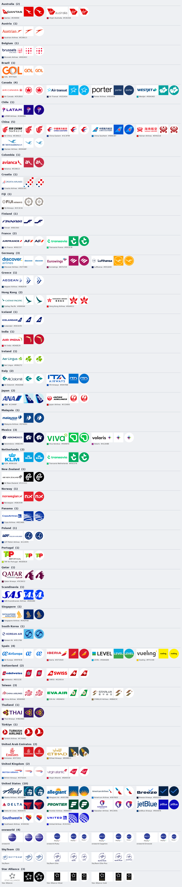

# Airline and alliance logos

Logos and icons for the 74 airlines in the calculator, the 3 alliances (oneworld, SkyTeam and Star Alliance) and 7 alliance status badges. `index.json` maps each key to its files, name, source and license.

## Logo sheet

Every full logo, square icon and circular icon, grouped by country (countries and airlines A to Z), then one group per alliance with its status badges. Each airline shows its brand color swatch and hex value:

## Keys

- An airline uses its calculator menu value, for example `united`, `american:aa` or `milesandmore:lh`.
- An alliance uses `alliance:oneworld`, `alliance:skyteam` or `alliance:star`.
- A status badge uses `status:<alliance>:<tier>`, for example `status:star:gold` or `status:skyteam:elite-plus`.

## Files for each key

| Field in `index.json` | Folder | What it is |
|---|---|---|
| `file` | this folder | The full logo (the wordmark with its symbol), PNG or SVG. |
| `square` | `square/` | A 512 by 512 square icon with square corners and a flat, single-color background. |
| `circle` | `circle/` | The same icon cut to a circle, transparent outside. |

The site itself loads two smaller copies, listed in `js/logos.json`:

- `menu/`: 64 by 64 copies of the circular icons, shown at 24 pixels beside each airline in the program menu.
- `small/`: the full logos (and the alliance logos and status badges) shrunk to 96 pixels tall, shown on the result.

The same icons are used in light and dark mode. On the result, logos sit on a white panel so they stay readable in dark mode.

## How the icons were made

- **Official app icons.** Most icons come from the airline's official app: the Apple App Store icon, or an app icon supplied by the site owner. `iconSource` in `index.json` names the app. Seasonal or promotional icons (such as a "Black Friday" band) were not used, or the promotion was removed.
- **Symbols cut from the full logo.** Airlines without a usable app icon use the symbol from their full logo, centered on white.
- **Cleanup.** Rounded corners and built-in frames were removed, and gradient backgrounds were flattened to one solid color.
- **Centering.** Each mark is optically centered: placed by a balance of its outer edges and where its shape is heaviest. Marks whose official artwork runs off the edge (ANA, Allegiant, Copa, Croatia, Delta, Etihad, Finnair, LEVEL, Qatar, SAS and United) are left as designed.

When you replace a full logo or icon, rebuild the matching `menu/` or `small/` copy so the site shows the change, and remake `logo-sheet.png`.

## Sources

- **Official files supplied by the site owner** (41 full logos), from airline and alliance media kits, including the status badges. The SkyTeam Elite badge was made for this site from the official Elite Plus badge by removing the word PLUS. The ITA Airways logo was taken from its app screen and recolored from white to blue.
- **Wikimedia Commons** (41 full logos). Each file page is linked in `index.json`. 27 are marked public domain on Commons; for the others, check the license on the file page.
- **The airline's own website** (1 full logo): Frontier, recolored to Frontier green.

`LICENSE.md` holds the license text for any remaining files from third-party icon sets.

## Trademarks

Every logo, icon and badge is a trademark of its airline or alliance. The licenses above cover copyright in the files, not the trademarks. Use them only to identify each airline or alliance, and never in a way that suggests the airline or alliance endorses or sponsors this site.

## Could be improved

- **Small source files.** Edelweiss, LOT, Hawaiian, China Airlines and Aeromexico icons came from small images and look soft at large sizes. Official SVG or large PNG files would sharpen them.
- **Wordmark-only icons.** Etihad, Air France, Discover, ANA, SAS, GOL, KLM, jetBlue and Allegiant use their app icon or wordmark rather than a separate symbol.
